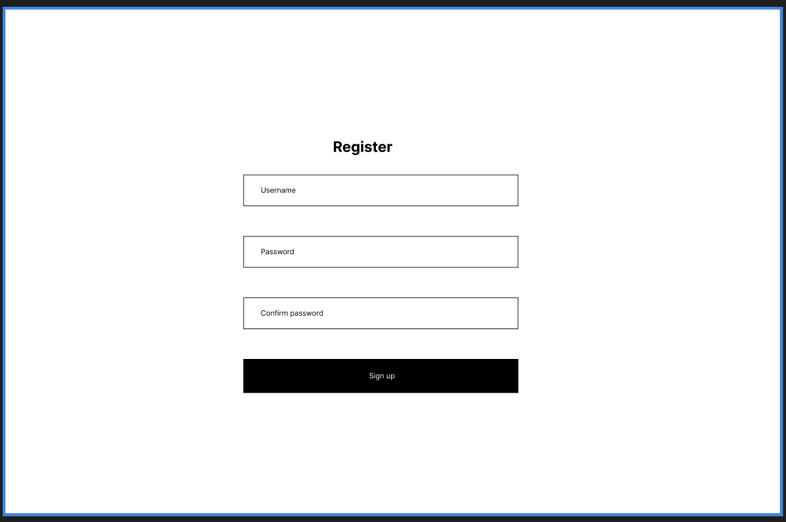
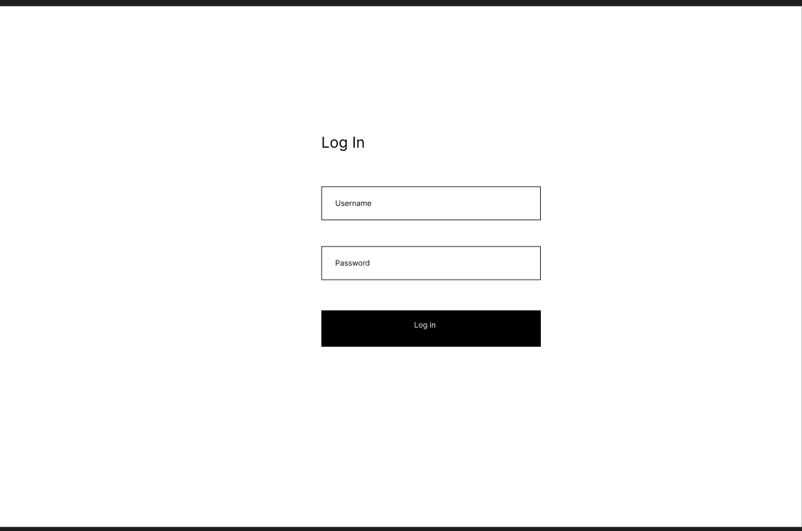
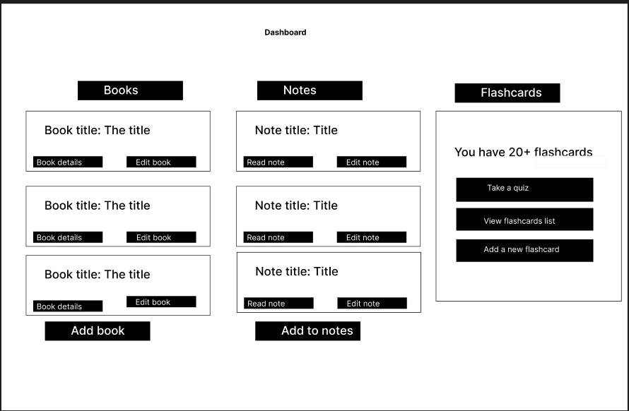
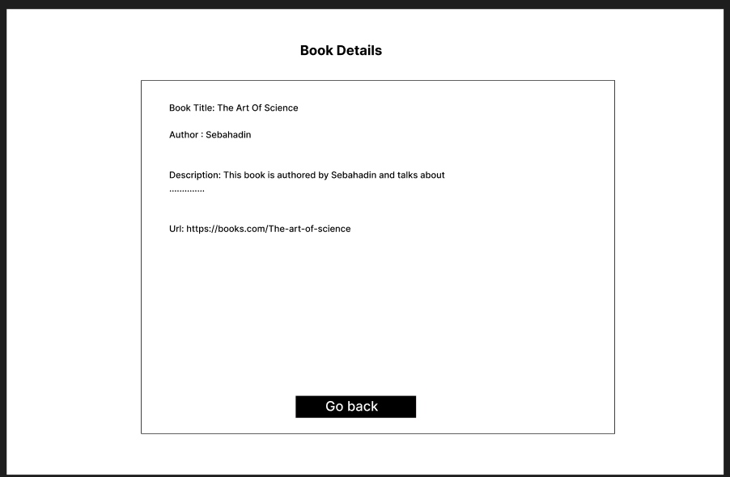
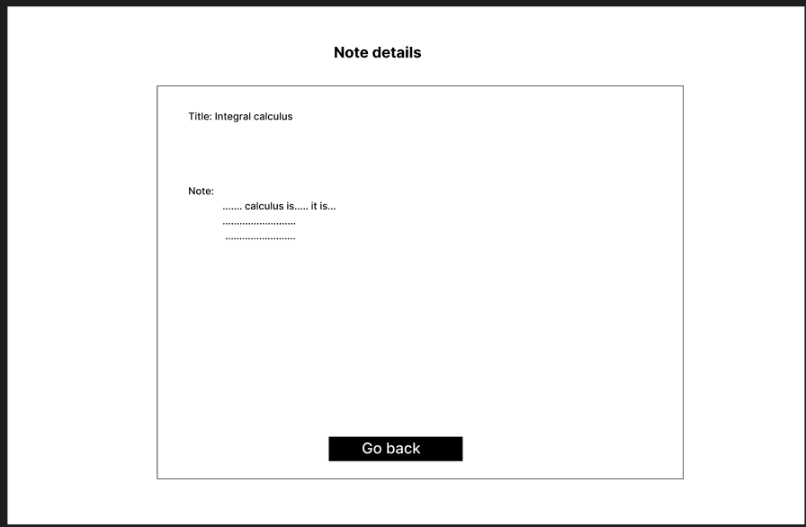
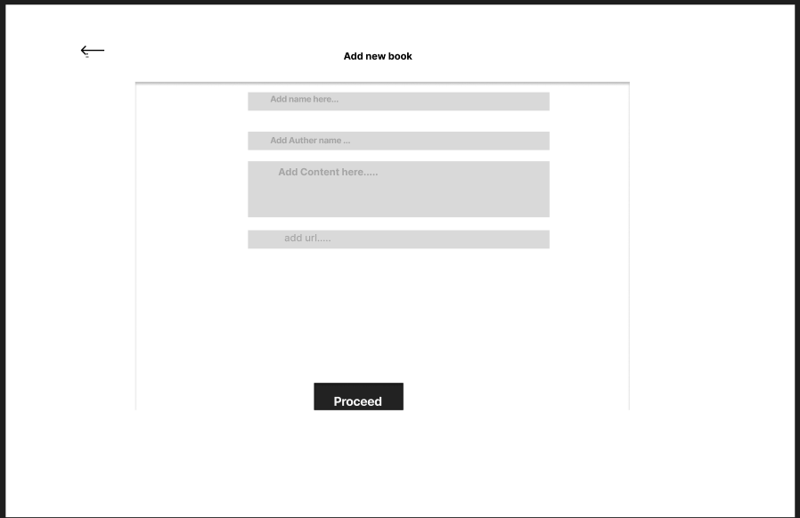
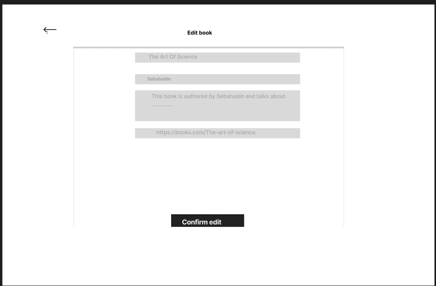
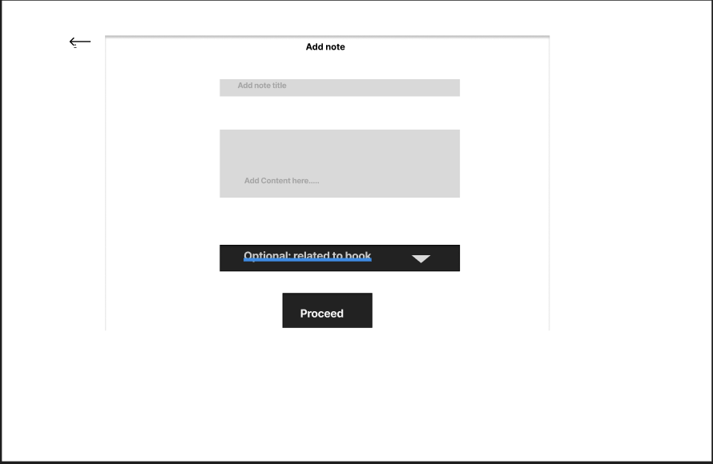
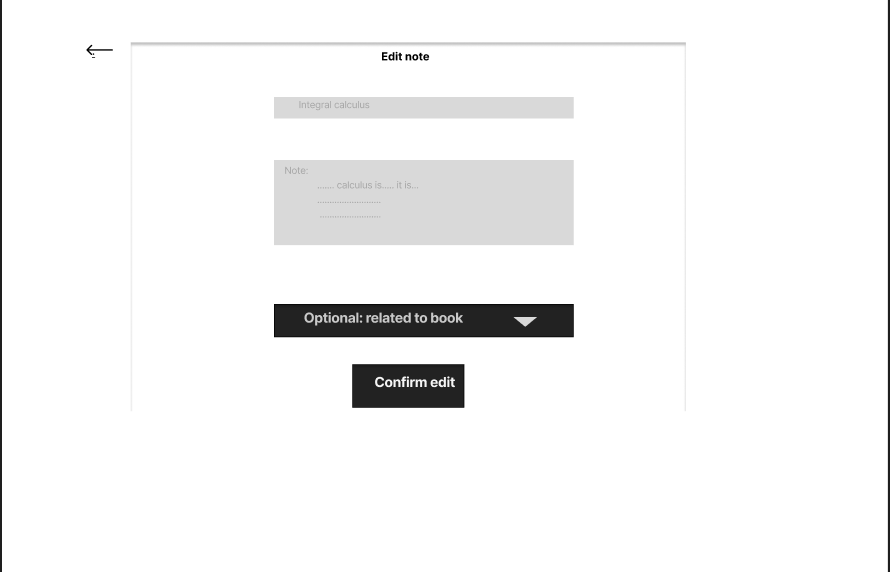
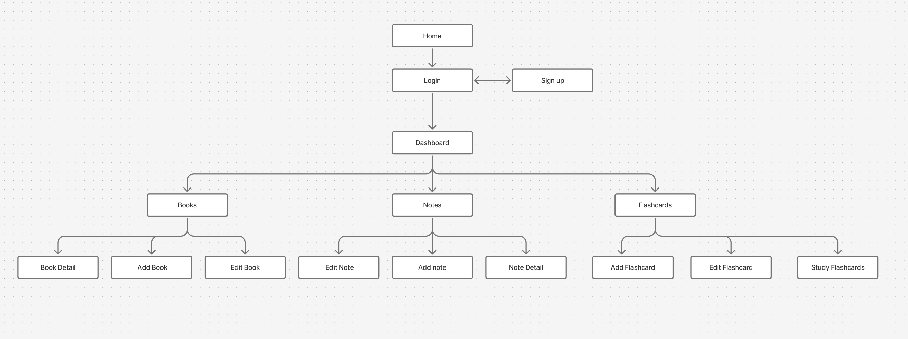

# AI-study-heper

## Overview  
**StudyHelper** is a personal academic web app that helps students organize and manage their learning resources in one place.  
Users can:  
- Manage a personal library of books and mark favorites  
- Write and edit study notes (optionally linked to books)  
- Create and study flashcards for self-testing  

The app uses **Express** and **MongoDB**, styled with **Tailwind CSS**, and will integrate **React** components in later milestones to support interactive features such as flashcard quiz mode.

---

## Data Model  

The application stores **Users**, **Books**, **Notes**, and **Flashcards**.  

* Each **User** can have many Books, Notes, and Flashcards.  
* Each **Note** may optionally reference a Book.  

### Example Schemas  

```js
// User
{
  username: String,
  email: String,
  password: String
}

// Book
{
  title: String,
  author: String,
  category: String,
  user: { type: mongoose.Schema.Types.ObjectId, ref: 'User' },
  isFavorite: Boolean
}

// Note
{
  title: String,
  content: String,
  user: { type: mongoose.Schema.Types.ObjectId, ref: 'User' },
  book: { type: mongoose.Schema.Types.ObjectId, ref: 'Book', default: null },
  createdAt: { type: Date, default: Date.now }
}

// Flashcard
{
  question: String,
  answer: String,
  user: { type: mongoose.Schema.Types.ObjectId, ref: 'User' },
  tags: [String],
  createdAt: { type: Date, default: Date.now }
}
```

---


## Sample Documents and Relationships

Below are sample documents that will be stored in the MongoDB database.
Each object represents one of the core entities (**User**, **Book**, **Note**, and **Flashcard**) and illustrates how they are related.

---

### 1. User Document

Represents an individual user of the StudyHelper application.

```json
{
  "_id": "userId",
  "username": "Sebahadin",
  "email": "seb@example.com",
  "password": "hashed_password_here"
}
```

Each user can have multiple books, notes, and flashcards linked to them.

The `_id` of the user is referenced in those related documents.

---

### 2. Book Document

Represents a book or study material added by the user.

```json
{
  "_id": "bookId",
  "title": "Clean Code",
  "author": "Robert Martin",
  "category": "Software Engineering",
  "user": "userId",
  "isFavorite": true
}
```

The `user` field references the `_id` from the **User** collection.

A user can have multiple books, but each book belongs to exactly one user.

---

### 3. Note Document

Represents a note written by a user. It can optionally be associated with a book.

```json
{
  "_id": "noteId",
  "title": "OOP Principles",
  "content": "Encapsulation, Inheritance, Polymorphism …",
  "user": "userId",
  "book": "bookId",
  "createdAt": "2025-10-29T14:00:00Z"
}
```

The `user` field references the author of the note (from **User**).

The `book` field optionally references a specific **Book** the note is about.


---

### 4. Flashcard Document

Represents a question–answer pair for studying.

```json
{
  "_id": "flashcardId",
  "question": "What is encapsulation?",
  "answer": "Hiding implementation details within a class.",
  "user": "userId",
  "tags": ["OOP", "midterm"],
  "createdAt": "2025-10-29T14:00:00Z"
}
```

The `user` field references the **User** who created the flashcard.

Each user can have multiple flashcards (one-to-many relationship).

Tags provide a way to categorize flashcards by topic or purpose.


---

## [Link to First Draft Schem Project File](./src/db.mjs)  

---

## Wireframes and Screens  

All screenshots are stored in the `/documentation/` folder and displayed below.  
Each image represents one core page or feature of **StudyHelper**.

---

### Authentication Pages  

**Register Page**  
  
Users can create an account by entering a username, password, and password confirmation.  

**Login Page**  
  
Registered users log in to access their personalized dashboard.  

---

### Dashboard and Details Pages  

**Dashboard Page**  
  
Displays three main sections — Books, Notes, and Flashcards — with quick actions to add, edit, or view content.  

**Book Details Page**  
  
Shows complete book information including title, author, description, and optional URL.  

**Note Details Page**  
  
Displays the full content of a note with a clean layout and a “Go Back” button for navigation.  

---

### Add and Edit Forms  

**Add Book Page**  
  
Form for adding a new book with fields for title, author, description, and optional URL.  

**Edit Book Page**  
  
Lets users update existing book details and confirm changes.  

**Add Note Page**  
  
Form for writing a new note with an optional dropdown to link it to a specific book.  

**Edit Note Page**  
  
Allows users to update note content and adjust related-book associations.  

---

### App Map  

  
Visual diagram showing the full navigation structure of StudyHelper — from authentication to dashboard and editing books and notes and adding books,notes, and creating flashcards.

---

## User Stories  

1. As a new user, I want to register an account so that I can securely store my study materials.  
2. As a registered user, I want to log in so that I can access my personal dashboard.  
3. As a user, I want to add books so that I can organize resources by subject.  
4. As a user, I want to edit or mark books as favorites so that I can highlight important ones.  
5. As a user, I want to write and link notes to books so that I can keep related information together.  
6. As a user, I want to create flashcards so that I can review topics efficiently.  
7. As a user, I want to edit and review notes and flashcards so that I can keep my content up to date.  

---
## Research Topics  

### 1. Passport.js Authentication (4 points)  
**What it is:** A Node.js middleware that simplifies user authentication using modular strategies like `passport-local`.  
**Why use it:** Provides secure login and session handling for StudyHelper, ensuring user data protection and smooth authentication flow.  
**Possible candidate modules or solutions:**  
- `passport`  
- `passport-local`  
- `express-session`  

---

### 2. Mocha Testing (3 points)  
**What it is:** A JavaScript testing framework for Node.js used to verify the correctness of backend logic and routes.  
**Why use it:** Ensures reliability and prevents regressions by automating backend testing for routes and database operations.  
**Possible candidate modules or solutions:**  
- `mocha`  
- `chai`  

---

### 3. Client-Side Validation with JustValidate (4 points)  
**What it is:** A lightweight and flexible JavaScript library for validating form inputs directly in the browser.  
**Why use it:** Enhances user experience by catching input errors (like password mismatch, empty fields, or invalid emails) before sending data to the server.  

**Possible candidate modules or solutions:**  
- `just-validate`  
- Custom event-based error rendering for inline feedback  

---

### 4. ESLint (2 points)  
**What it is:** A static code analysis tool that identifies and fixes code style and syntax issues in JavaScript projects.  
**Why use it:** Maintains code consistency, readability, and prevents potential bugs by enforcing standard style rules across all source files.  
**Possible candidate modules or solutions:**  
- `eslint`  
- `eslint-plugin-import`, `eslint-plugin-node`  

---

**Total Points: 13**  
(*React was originally planned but has been replaced with ESLint and JustValidate to better align with project scope and milestone progress.*)

---

## [Link to Initial Main Project File](./src/app.mjs)  

## [Link to app map and wireframe images Project File](/documentation/)  
